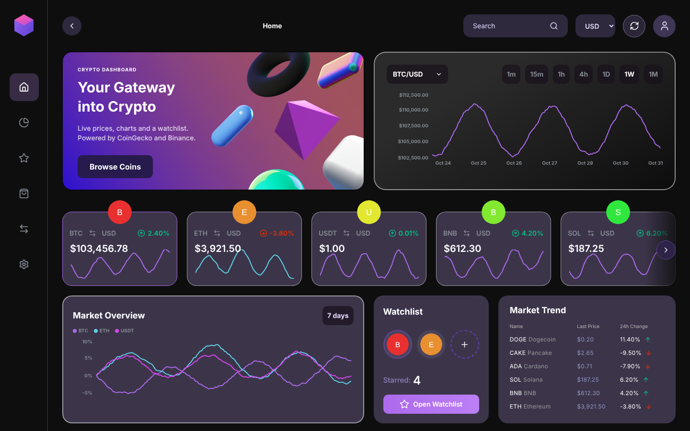
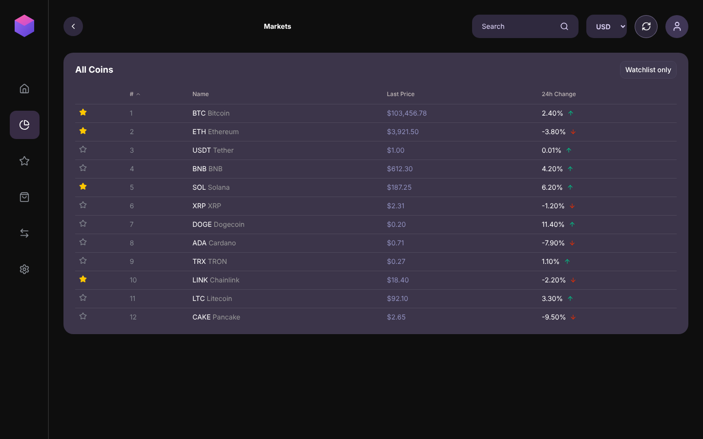
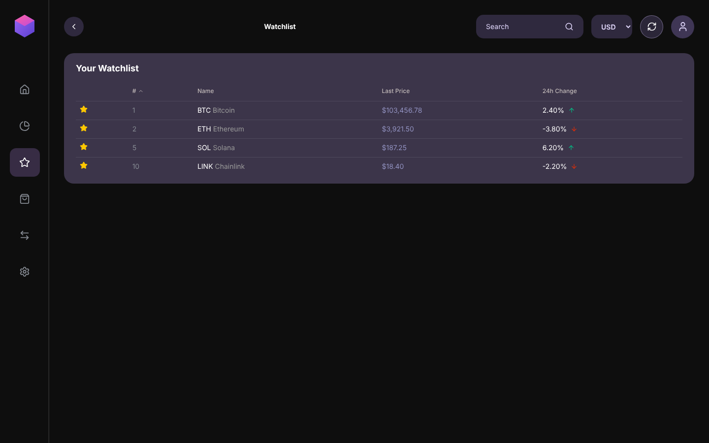
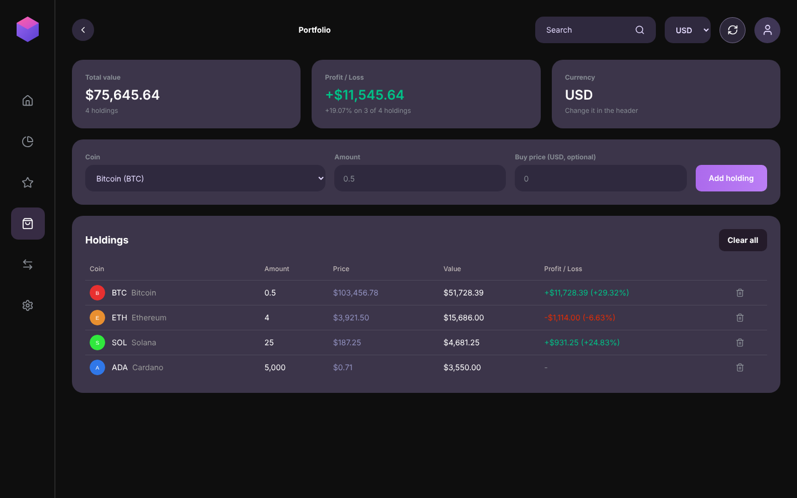
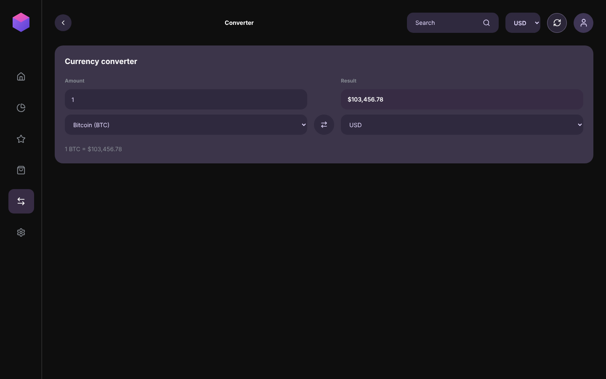
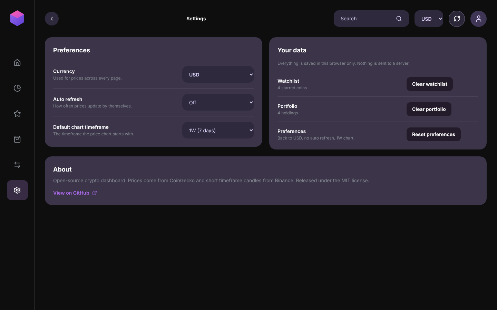

# Crypto Dashboard

An open-source cryptocurrency dashboard built with Next.js. It shows live prices for the top 250 coins, price charts from 1 minute to 1 month, a persistent watchlist, a portfolio tracker, a currency converter and multi-currency support.



## Screenshots

Screenshots use sample data, not live prices.

<table>
  <tr>
    <td width="50%"><br><sub>Markets</sub></td>
    <td width="50%"><br><sub>Watchlist</sub></td>
  </tr>
  <tr>
    <td width="50%"><br><sub>Portfolio</sub></td>
    <td width="50%"><br><sub>Converter</sub></td>
  </tr>
  <tr>
    <td width="50%"><br><sub>Settings</sub></td>
    <td width="50%"></td>
  </tr>
</table>

## Features

- Market table with the top 250 coins by market cap, live search, sortable columns and 24h change indicators
- Price chart with 1m, 15m, 1h, 4h, 1D, 1W and 1M timeframes
- Top coin cards with 7-day sparklines
- Market overview comparing the 7-day performance of the top 3 coins
- Market trend list with the biggest 24h movers
- Watchlist saved in the browser (localStorage)
- Portfolio tracker with total value and profit / loss, saved in the browser
- Converter between crypto and fiat currencies, or between two coins
- Settings for currency, auto refresh interval and the default chart timeframe
- 7 display currencies: USD, IDR, EUR, JPY, GBP, AUD, SGD
- Loading skeletons, error states with retry, and empty states
- Responsive layout
- Unit tests for the portfolio, converter and formatting logic

## Pages

| Route | Description |
| --- | --- |
| `/` | Overview with the price chart, top coins, market overview and market trend |
| `/markets` | All coins with search and sortable columns. Accepts `?q=` to prefill the search |
| `/watchlist` | Coins you starred |
| `/portfolio` | Your holdings, total value and profit / loss |
| `/converter` | Convert between coins and fiat currencies |
| `/settings` | Currency, auto refresh, default chart timeframe and saved data |

## Tech Stack

- [Next.js](https://nextjs.org) 16 (App Router, Route Handlers) and React 19
- TypeScript
- Tailwind CSS v4 and [shadcn/ui](https://ui.shadcn.com) (Base UI)
- [TanStack Query](https://tanstack.com/query) for data fetching and caching
- [Zustand](https://zustand-demo.pmnd.rs) for client state
- [Zod](https://zod.dev) for response validation
- [Recharts](https://recharts.org) for charts
- [lucide-react](https://lucide.dev) for icons
- [Vitest](https://vitest.dev) for unit tests

## Getting Started

### Requirements

- Node.js 20.9 or newer
- npm

### Installation

```bash
git clone https://github.com/LewzzJrs/crypto-dashboard.git
cd crypto-dashboard
npm install
```

### Run in development

```bash
npm run dev
```

Open [http://localhost:3000](http://localhost:3000).

### Build for production

```bash
npm run build
npm start
```

### Other scripts

| Script | Description |
| --- | --- |
| `npm run dev` | Start the development server |
| `npm run build` | Create a production build |
| `npm start` | Run the production build |
| `npm run lint` | Run ESLint |
| `npm test` | Run the unit tests once |
| `npm run test:watch` | Run the unit tests and re-run them on file changes |

## Testing

Unit tests use [Vitest](https://vitest.dev) and live next to the code they test as `lib/*.test.ts`. They cover the pure logic: profit / loss and totals in `lib/portfolio.ts`, unit conversion in `lib/converter.ts` and number formatting in `lib/format.ts`. They use fixed sample data and never call the network.

```bash
npm test
```

## Environment Variables

No environment variables are required. Both data sources are public and need no API key. `.env.example` is included for reference and will list any variables added in the future.

## Data Sources

| Data | Source |
| --- | --- |
| Coin list, prices, sparklines, 1D / 1W / 1M charts | [CoinGecko](https://www.coingecko.com/en/api) public API |
| 1m, 15m, 1h and 4h charts | [Binance](https://developers.binance.com/docs/binance-spot-api-docs) public market data |

Notes:

- The browser never calls these APIs directly. Requests go through Route Handlers under `app/api`, which avoids CORS errors and lets Next.js cache the responses (60 seconds for the coin list, 5 minutes for CoinGecko charts, 15 seconds to 5 minutes for Binance candles).
- The CoinGecko free plan is rate limited. If you see request errors, wait a moment and use the retry button.
- Short timeframes use Binance USDT pairs, so prices are shown in USDT and only coins listed on Binance are available. Other coins show a message and can still use 1D, 1W and 1M.

## Project Structure

```
app/
  api/
    coins/              CoinGecko market list and per-coin charts
    candles/            Binance candles for short timeframes
  markets/ watchlist/ portfolio/ converter/ settings/   One page per route
  layout.tsx
  page.tsx
components/             Page views and dashboard sections (header, cards, charts, table)
  ui/                   shadcn/ui primitives
hooks/                  TanStack Query hooks
lib/                    API client, schemas, formatters, constants, and their unit tests (*.test.ts)
stores/                 Zustand stores (currency, watchlist, portfolio, settings)
public/hero/            3D images used in the home banner
docs/screenshots/       Screenshots used in this README
```

## Design

The interface follows a dashboard design made in Figma: dark background, purple accents, glass-style cards and 3D shapes in the home banner. The Figma file is not part of this repository.

## Contributing

Contributions are welcome.

1. Fork the repository
2. Create a branch: `git switch -c feat/your-feature`
3. Commit using [Conventional Commits](https://www.conventionalcommits.org), for example `feat: add price alerts`
4. Push the branch and open a pull request

Please run `npm run lint` and `npm test` before opening a pull request.

## License

Released under the [MIT License](LICENSE).
